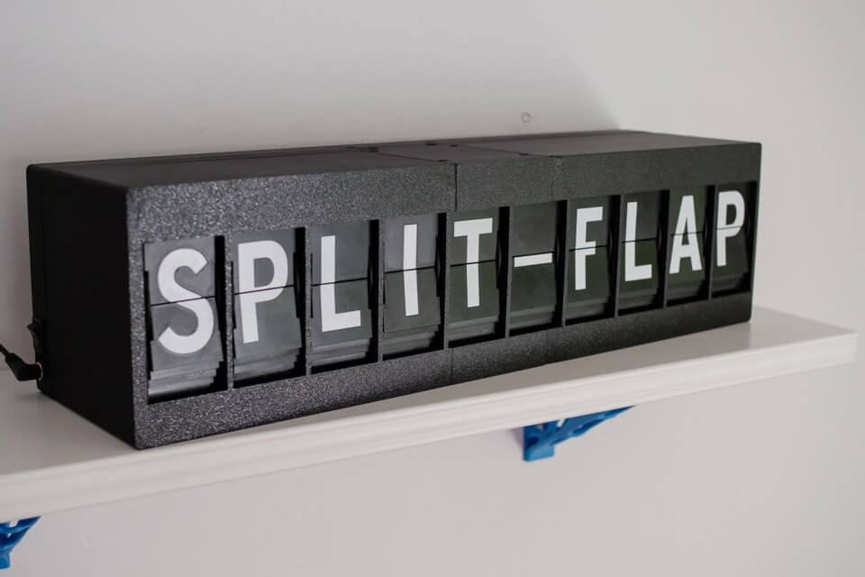

# Split-Flap

[](https://github.com/sdylewski/split-flap/actions/workflows/firmware.yml)



This fork builds on the brilliant [original project](https://github.com/Dave19171/split-flap) by
[David Königsmann](https://github.com/Dave19171) and adds an ESP32 master with a modern web
UI, OTA updates, message scheduling, a console for in-place calibration, unit diagnostics and
rewritten firmware, while keeping the 3D-printable mechanical design.

## Feature Highlights

- ESP32 master with a fast web UI at `http://flappy.local`: text, clock, date, countdown,
  train station, random phrases and famous numbers, scheduled messages and quiet hours
- One console on the web page, telnet and USB serial, including **calibrating units in
  place** (press Enter when a flap drops)
- Unit firmware that re-syncs at every magnet pass, learns its motor's steps per turn and
  reports diagnostics: supply voltage, slipping, missed magnets, reboots, I2C errors
- Self-healing I2C bus, status LED blink codes, one log with levels everywhere
- Live data: weather, real-time BART departures, Klipper 3D printer progress and "print done"
  alerts, plus a wave reveal effect - see [`docs/integrations.md`](./docs/integrations.md)
- Messages from Home Assistant, Siri Shortcuts or any HTTP client
- OTA updates, JSON API, crash reports over WiFi, PlatformIO builds with pinned versions and CI

## Documentation

All documentation lives under [`docs/`](./docs):

| Topic | Description |
|---|---|
| [`docs/README.md`](./docs/README.md) | Docs hub + quick start |
| [`docs/printing.md`](./docs/printing.md) | BOM, screw list, printed parts, flap tips |
| [`docs/hardware-build.md`](./docs/hardware-build.md) | PCB soldering, unit assembly, enclosure |
| [`docs/esp32.md`](./docs/esp32.md) | Wiring the ESP32 master into the ESP-01 header |
| [`docs/software.md`](./docs/software.md) | Building and flashing both firmwares, web UI, settings, API, troubleshooting |
| [`docs/console.md`](./docs/console.md) | Console commands, calibration, reading the diagnostics |
| [`docs/integrations.md`](./docs/integrations.md) | Weather, BART, 3D printers, wave reveal, Home Assistant, Siri |
| [`docs/SplitFlapInstructions.md`](./docs/SplitFlapInstructions.md) | Legacy PDF converted to Markdown |

## Repository Structure

```
.
├── firmware/
│   ├── master/      # ESP32 master (PlatformIO): src/, web/ (UI), test/
│   ├── unit/        # Arduino Nano unit firmware (PlatformIO), flash.sh
│   └── shared/      # unit_protocol.h - the I2C protocol both sides use
├── docs/            # Documentation
├── PCB/             # Schematics, Gerbers, pick-and-place
├── 3dModels/        # Printable parts
├── legacy/          # Previous Arduino IDE firmware (ESP-01 master, unit 1.3.0, USB calibration tools)
└── Images/, Instructions/
```

## Getting Started

1. Print and source parts: [`docs/printing.md`](./docs/printing.md)
2. Assemble the PCBs, units and enclosure: [`docs/hardware-build.md`](./docs/hardware-build.md)
3. Wire the ESP32: [`docs/esp32.md`](./docs/esp32.md)
4. Flash, calibrate and use it: [`docs/software.md`](./docs/software.md)

Have improvements or fixes? Contributions are welcome - open an issue or a pull request.
