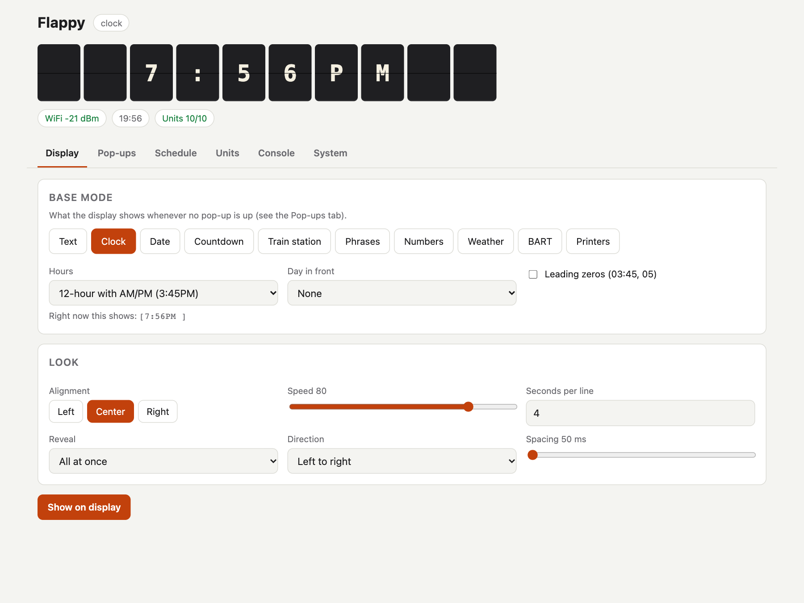

# Build Guide: ESP32 Master and Unit Firmware 2.x

This guide takes a split-flap display built from the original design (ESP-01S master, Arduino Nano
units) to this fork's firmware: an ESP32 master jumpered into the ESP-01 socket, and unit firmware
2.x on every Nano. Plan an evening: about an hour for the wiring and flashing, plus calibration.

You don't need to change the PCB or the units' wiring.

<!-- PHOTO: images/build/finished-display.jpg - the finished display showing the clock -->

## What you need

| Item | Notes |
|---|---|
| An original ESP32 dev board | ESP32-WROOM-32: "ESP32 Dev Module", DevKitC, mini D1 ESP32. Not an S2/S3/C3/C6 |
| 3-4 jumper wires, or wire to solder | From the ESP-01 header (U2) to the ESP32 |
| USB cables | One for the ESP32, a Mini-USB one for the Nanos |
| A Mac, Linux or Windows computer | With Python 3.10-3.14 |
| Your WiFi name and password | 2.4 GHz |

## 1. Wire the ESP32 into the ESP-01 header

The ESP32 takes the place of the ESP-01S. Only three connections are needed on header **U2**
(pin 1 is the square pad):

| U2 pin | Signal | ESP32 pin |
|---|---|---|
| **8** | TX = I2C **SDA** | **GPIO21** |
| **4** | RX = I2C **SCL** | **GPIO22** |
| **1** | **GND** | **GND** |
| 5 | +3.3 V | 3V3 (only if you power the ESP32 from the header, see below) |
| 2, 3, 6, 7 | IO2, IO0, RST, EN | not connected |

```
U2, seen from the top (pin 1 = square pad):

  1 GND        2 IO2    3 IO0    4 RX = SCL  -> GPIO22
  8 TX = SDA   7 EN     6 RST    5 VCC 3.3V
  -> GPIO21
```

**Power** - pick one:

- **ESP32 3V3 to U2 pin 5**: the display's 3.3 V regulator (AMS1117, 800 mA) powers the ESP32.
  Simplest.
- **5 V into the ESP32's 5V/VIN pin** from elsewhere on the board, pin 5 left open. The ESP32's own
  regulator does the work.

Don't connect both. The USB cable can stay plugged in either way.

The board already has BSS138 level shifters on SDA and SCL, so the 3.3 V ESP32 and the 5 V Nanos
talk without anything extra. Details and the reasoning: [esp32.md](./esp32.md).

<!-- PHOTO: images/build/esp32-wiring.jpg - ESP32 jumpered to U2, close-up of the three wires -->
<!-- PHOTO: images/build/esp32-mounted.jpg - the ESP32 mounted in the display -->

## 2. Install the tools

Install [PlatformIO](https://platformio.org), either:

- the **PlatformIO IDE** extension for VS Code, then open `firmware/master` (and later
  `firmware/unit`) as a folder; or
- the command line:

  ```sh
  pipx install --python python3.14 platformio
  ```

  PlatformIO's ESP32 platform needs Python 3.10-3.14. A newer `python3` (e.g. 3.15 pulled in by
  Homebrew's `platformio` formula) is rejected - that's why the pipx line pins 3.14.

Everything else (ESP32 core 3.3.12, compilers, libraries) is downloaded on the first build, at the
exact versions pinned in `platformio.ini`.

## 3. Set your WiFi and network

```sh
cd firmware/master
cp src/secrets.h.example src/secrets.h
```

Edit `src/secrets.h`: your WiFi name, password, and an OTA password (used for updates over WiFi -
make it longer than a few digits). The file is git-ignored.

In `src/config.h`, check the network block: by default the display takes the fixed address
`192.168.0.111` with gateway `192.168.0.1`. Change those to fit your network, or set
`NET_STATIC_IP 0` to get an address from your router. Either way it's reachable as
**`flappy.local`**.

## 4. Flash the master

Plug the ESP32 into USB:

```sh
cd firmware/master
pio run -t upload        # firmware
pio run -t uploadfs      # web UI
pio device monitor       # watch it start (Ctrl+C to quit)
```

If an upload hangs at `Connecting...`, hold the ESP32's **BOOT** button until it starts writing.

In the monitor you should see it connect to WiFi, set the clock and find the units:

```
I boot: split-flap master 4.1.0 ..., reset reason: power on
I wifi: found 3 access point(s) for "..." - joining the strongest: ..., -40 dBm
I units: unit 0 answering: ready, firmware 2.3.0
...
```

The ESP32's LED shows where it is: 1 blink = connecting to WiFi, 2 = waiting for the time,
a short blip every 3 s = running, 3 blinks = a unit is missing
([all codes](./software.md#52-status-led-esp32-gpio2)).

Open **http://flappy.local** in a browser.



## 5. Flash the units

Every Nano gets unit firmware 2.x. It keeps the calibration offset already stored in the Nano, so
units calibrated with the original firmware keep their calibration.

For each unit: plug its Nano into USB (the display can stay powered) and run

```sh
firmware/unit/flash.sh
```

It finds the port, tries the new Nano bootloader first and falls back to the old one. Nanos with
the new bootloader also get a watchdog that restarts a hung unit.

Then check the **DIP switches**: the leftmost unit must be address 0, the next 1, and so on. In the
web UI's **Console** tab (or `nc flappy.local 23`) run:

```
ident      every unit shows its own address: 0123456789 left to right
status     each unit's status and firmware
resume     back to normal
```

If `ident` reads backwards or out of order, fix the DIP switches on the units that are wrong.

<!-- PHOTO: images/build/ident.jpg - the display showing 0123456789 during ident -->

## 6. Calibrate

Each unit needs its **offset**: the steps from the magnet to the middle of the blank flap. In the
console:

```
cal 3
```

The unit turns to its magnet and asks which flap is showing. It then creeps forward - press
**Enter** each time a flap drops. After five drops it suggests an offset and asks to save it.
Check with `unit 3 A`, `unit 3 9`, `unit 3 !`. Walkthrough: [console.md](./console.md#calibrating-a-unit-cal).

Quick nudge instead: a unit showing the flap *before* the right one needs a bigger offset, one
showing the flap *after* a smaller one; one flap is about 45 steps (`offset 3 520`).

Run `units` afterwards. After a few full turns each unit reports the steps per turn it learned
from its magnet (2048 or 2038, depending on the motor's gearing) and how far its count was off at
the last magnet pass - near 0 means it's tracking well.

## 7. Set it up

In the web UI:

- **Display**: the base mode - clock (12/24-hour, AM/PM, day in front), date, text, countdown,
  weather, BART, 3D printers, train station lines (BART, New York, Chicago, Paris, Copenhagen, ...),
  random phrases, famous numbers (with editable preset lists); alignment, speed, wave reveal.
- **Pop-ups**: what may interrupt the base mode, with priority, duration, timer, hours and days -
  e.g. clock all day, BART every 10 minutes on weekday mornings, "PRINTY DONE" whenever a print
  finishes.
- **Schedule**: one-off or repeating messages, and quiet hours (with power saving at night).
- **System**: time zone, number of units, log.

More: [software.md](./software.md) and [integrations.md](./integrations.md) (weather, BART,
printers, Home Assistant, Siri).

## 8. Updates over WiFi

Once it's running, the master can be updated without the USB cable:

```sh
cd firmware/master
export FLAPPY_OTA_PASSWORD='the SECRET_OTA_PASSWORD from secrets.h'
pio run -e ota -t upload      # firmware
pio run -e ota -t uploadfs    # web UI
```

Settings are kept in the ESP32's NVS, so neither upload touches them. During quiet hours an update
doesn't move the flaps.

Units are updated over USB (`flash.sh`), but most unit settings are **parameters** you can change
from the console without reflashing (`param all led 0`, see [console.md](./console.md#unit-parameters-param)).

## If something doesn't work

| Symptom | Look at |
|---|---|
| No unit answers | SDA/SCL swapped (pin 8 -> GPIO21, pin 4 -> GPIO22), GND missing, or the units have no power. The log line `I2C bus check: SDA ..., SCL ...` says if a line is stuck low |
| `flappy.local` doesn't load | The serial log (`pio device monitor`): WiFi errors, or "web files missing" = run `pio run -t uploadfs` |
| A unit shows the neighbouring flap | Its offset: `cal <addr>` |
| A unit misses the magnet / slips | `units`: the `miss` and `err` columns; check the magnet and the hall sensor gap |
| The ESP32 rebooted unexpectedly | `crash` in the console shows the last crash report |

The full list: [software.md](./software.md#53-common-problems).
