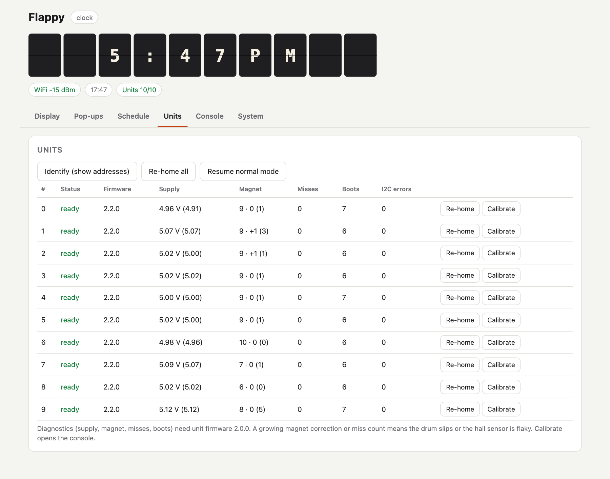

# Console

The master has a command console for testing, calibrating and diagnosing the display. It runs
in three places at once, with the same commands everywhere:

| Where | How |
|---|---|
| Web page | `http://flappy.local`, **Console** tab |
| Telnet | `nc flappy.local 23` (or `telnet flappy.local`) |
| USB serial | `pio device monitor` in `firmware/master` (115200 baud) |

Replies go to the console that typed the command. Commands run one at a time between display
updates, so a command can wait a few seconds while flaps are still moving.


## Commands

| Command | What it does |
|---|---|
| **Display** | |
| `show <text>` | Show text now, left aligned. Pauses the normal mode until `resume` |
| `text <text>` | Switch to text mode with this text (saved) |
| `mode <name>` | `text` `clock` `date` `countdown` `trainstation` `randomphrase` `famousnumbers` `weather` `bart` `printers` |
| `unit <addr> <char>` | One character on one unit (`blank` for the blank flap) |
| `ident` | Every unit shows its own address: `0123456789` left to right |
| `pause` / `resume` | Stop / restart the normal mode |
| `notify <seconds> <text>` | Show text for a while, then back to the current mode |
| `weather` | Show the weather data (and why the last download failed, if it did), and download it again now |
| **Units** | |
| `status [all]` | Status and firmware of each unit (`all` checks addresses 0-15) |
| `units` | Diagnostics table (see below) |
| `events [addr]` | Fetch the units' event logs into the log now (normally every 15 s) |
| `scan` | List every I2C address that answers |
| `cal <addr> [flips]` | Interactive calibration (below), default 5 flips |
| `offset <addr> <steps>` | Set a unit's offset and re-home it |
| `home <addr>` | Move to the magnet edge with no offset (sensor check) |
| `rehome <addr\|all>` | Full turn to the magnet + offset, then blank |
| `unitreboot <addr>` | Restart a unit |
| `i2creset` | Free a stuck I2C bus (also done automatically) |
| `param <addr\|all>` | List a unit's parameters (settings stored on the unit, 2.1+) |
| `param <addr\|all> <name> <value>` | Change one, e.g. `param all led 0` |
| `param <addr\|all> reset` | All parameters back to their defaults (the offset is kept) |
| **Settings & system** | |
| `settings` | All settings as JSON |
| `set <key> <value>` | Change a setting: `set speed 60`, `set quietEnabled true` |
| `info` | Firmware, uptime, reset reason, memory, flash |
| `wifi` / `time` | WiFi details and disconnect reasons / clock and time zone |
| `log <level\|off>` | Stream the log into this console (`debug` `info` `warn` `error`). On serial it sets the serial log level |
| `crash [clear]` | Last crash report (task, address, reason, backtrace) / erase it |
| `reboot` | Restart the ESP32 |
| `quit` | Close a telnet session |

## Checking the unit order

Run `ident`. Reading left to right the display should show `0123456789`. If not, a unit's DIP
switches don't match its position: the leftmost unit must be address 0. `resume` when done.

## Reading `units`



The same table is in the console (`units`):

```
addr fw     status       letter  vcc(min)    syncs miss  err(max) boots steps reset     up     i2c-err
  3  2.1.0  ready         'A'   5023(4987)     12    0   +1(  2)     4  2048 ?            35m  0
```

| Column | Meaning | Worry when |
|---|---|---|
| `vcc(min)` | Supply at the Nano in mV, now (lowest while the motor ran) | min below ~4600 |
| `syncs` | Times the drum passed the magnet and re-synced its position | |
| `miss` | Magnet not found where expected | anything above 0 that keeps growing |
| `err(max)` | Steps the count was off at the last magnet pass (largest since boot) | max above ~10 on a 2.1 unit |
| `boots` | Power-ups since the counter started | jumps without a power cut (brown-outs) |
| `steps` | Steps per turn the unit uses (learned by 2.1 units) | far from 2038/2048 |
| `i2c-err` | Failed transfers to this unit (master side) | climbing steadily |

## Unit parameters (`param`)

Units with firmware 2.1+ keep their settings in their own EEPROM, so they can be changed from
the console without reflashing. Changes take effect right away and survive power cuts.

| Parameter | Default | Range | What it does |
|---|---|---|---|
| `stepsPerRev` | 2048 | 2000-2100 | Steps per drum turn (learned automatically while `learnSteps` is 1) |
| `learnSteps` | 1 | 0-1 | Measure steps per turn between magnet passes and update `stepsPerRev` |
| `moveGuardMs` | 2000 | 0-10000 | Minimum ms between the starts of two moves (overheating guard) |
| `holdMs` | 100 | 0-1000 | ms the coils stay on after a move (stops coasting) |
| `magnetTolerance` | 60 | 10-500 | Steps past the expected magnet before it counts as missed |
| `homeBackoff` | 50 | 0-500 | Homing that starts on the magnet first moves this far off it |
| `homeTurns` | 3 | 1-5 | Turns to search for the magnet before giving up |
| `homeRpm` | 10 | 1-15 | Speed for homing at power-up |
| `maxRpm` | 15 | 1-20 | Speed limit, whatever the master asks for |
| `reverse` | 0 | 0-1 | Turn the motor the other way |
| `hallActiveLow` | 1 | 0-1 | 1 = hall sensor goes LOW at the magnet, 0 = HIGH |
| `sync` | 1 | 0-1 | Correct the position at every magnet pass |
| `syncLogSteps` | 3 | 0-100 | Log a correction event when the error is bigger than this |
| `lowVccMv` | 4500 | 3000-5500 | Low-voltage warning threshold while moving |
| `calTimeoutS` | 300 | 30-3600 | Leave calibration mode after this long without commands |
| `jogTimeoutS` | 60 | 5-600 | Stop creeping (calibration) after this long |
| `led` | 1 | 0-1 | Onboard "L" LED lights while the motor runs |

The list (`param 3`) marks values that differ from the default with `*`. The calibration
offset isn't a parameter: set it with `cal` or `offset`.

## Calibrating a unit (`cal`)

Needs unit firmware 1.3.0 or newer.

1. `cal 3`. The unit turns to its magnet and stops exactly at the magnet edge.
2. It asks which flap is showing. Type it and press Enter (`blank` for the blank flap).
3. The unit creeps forward. **Press Enter the moment the next flap drops.** It then moves
   quickly most of the way to the next flap and creeps again. This repeats for 5 flaps
   (`q` + Enter finishes early, `x` aborts). In the web console just press Enter in the
   empty input box.
4. It fits a straight line through the drop positions and reports the measured steps per flap
   and the new offset: where the blank flap drops, plus half a flap, so each letter sits in the
   middle of its window.
5. Answer `y` to save. The unit stores the offset and re-homes with it.
6. Check a few letters, especially late ones: `unit 3 A`, `unit 3 9`, `unit 3 !`, then `resume`.

### Quick fixes without `cal`

If a unit shows the flap *before* the one it should, its offset is too small. If it shows the
flap *after*, the offset is too big. One flap is about 45 steps: `offset 3 520`.

## Protocol

The master and units talk I2C at 50 kHz. The full protocol (commands, status reply, the
diagnostics block and event codes) is in
[`firmware/shared/unit_protocol.h`](../firmware/shared/unit_protocol.h). In short:

| Bytes to a unit | Meaning |
|---|---|
| `[letter, rpm]` | Show a flap (0-44) |
| `[letter, rpm, offsetLo, offsetHi]` | Show a flap and store a new offset |
| `[0xF1, rpm]` / `[0xF2, rpm, lo, hi]` / `[0xF3, ms]` / `[0xF4]` | Calibration: home, move N steps, creep, stop |
| `[0xF5]` / `[0xF6]` | Next read returns the diagnostics block / the event log (2.0+) |
| `[0xF7, lo, hi]` / `[0xF8, rpm]` / `[0xF9]` / `[0xFA]` | Set offset / re-home / reboot / clear counters (2.0+) |
| `[0xFB, id]` / `[0xFC, id, lo, hi]` / `[0xFD]` | Get / set / reset unit parameters (2.1+) |

A status read returns `[status, positionLo, positionHi, firmwareVersion]`.
