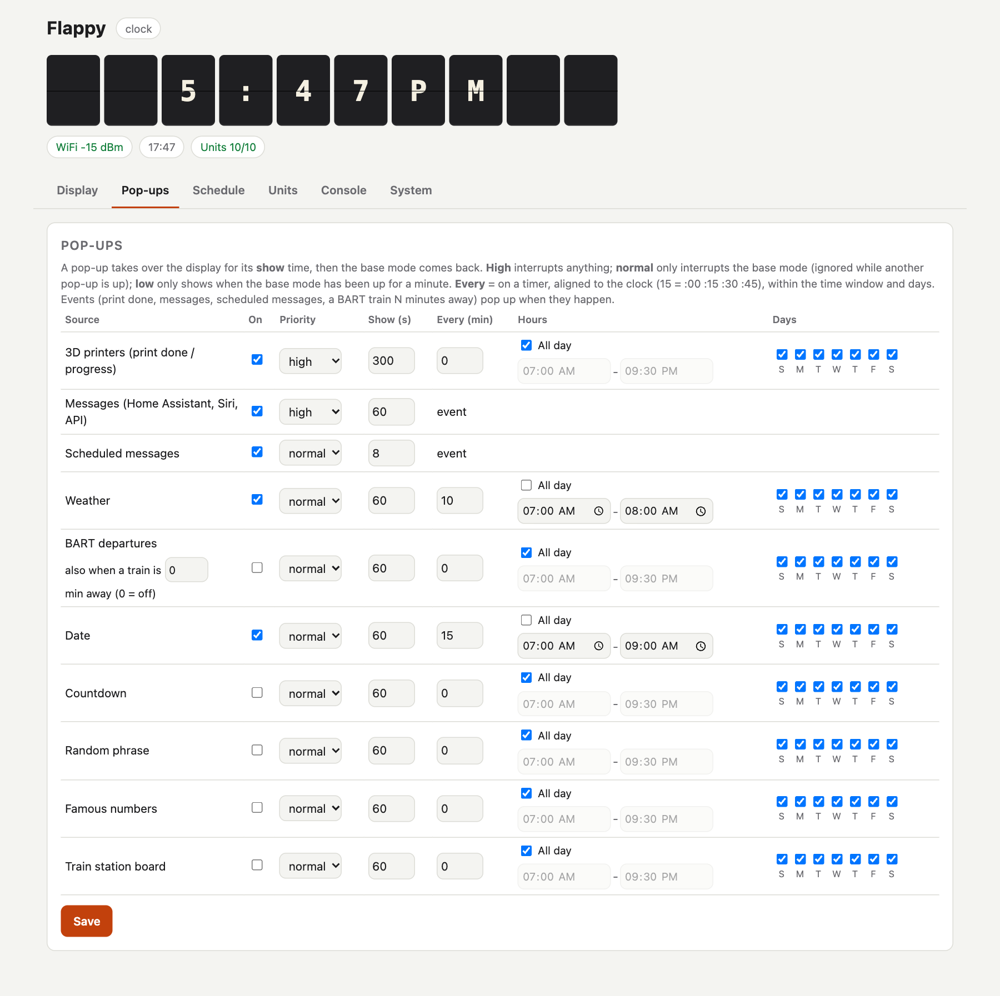
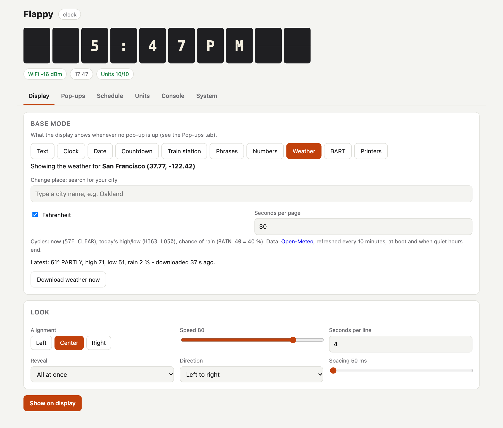
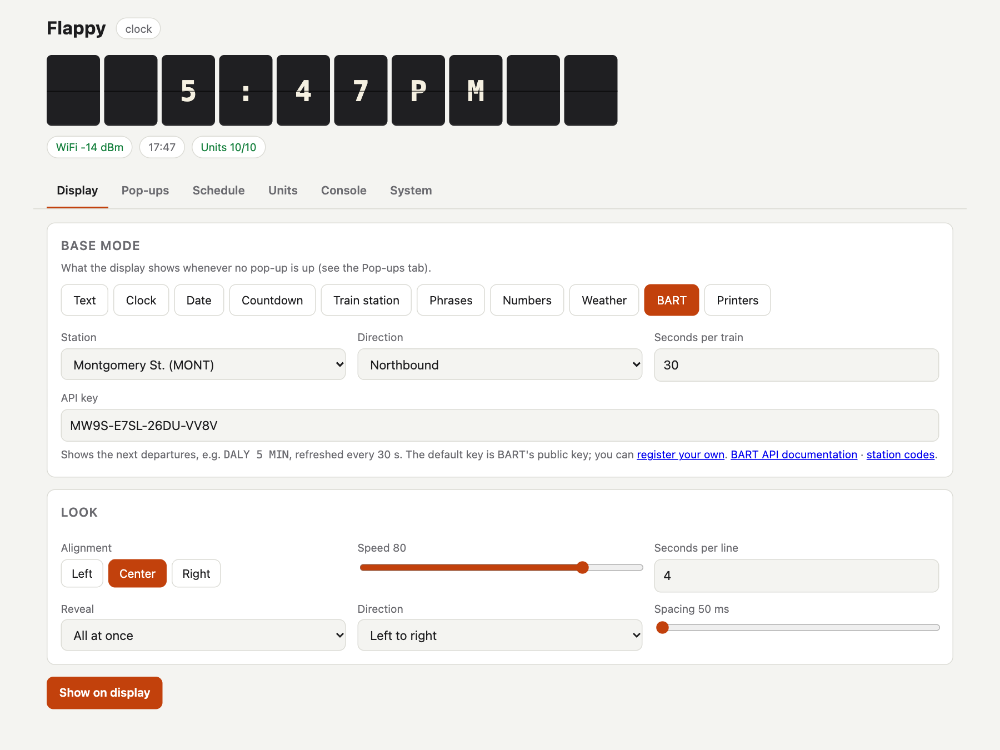
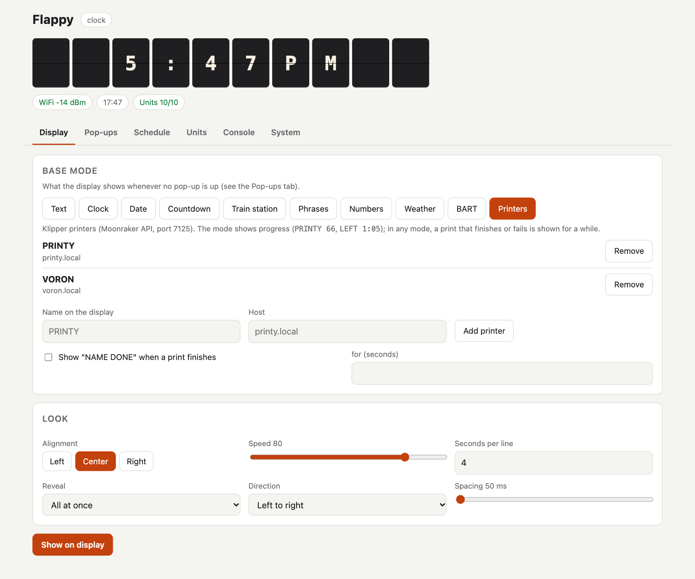

# Live Data and Integrations

The display can show live data (weather, BART departures, 3D printers) and take messages from
Home Assistant, Siri or anything else that can send an HTTP request. Live data is fetched by a
background task on the ESP32, so a slow website never stalls the flaps.

Everything here is set up in the web UI (`http://flappy.local`, Display and Pop-ups tabs) or with
the API (`POST /api/settings`, see [software.md](./software.md#26-api)).

## Base mode and pop-ups



The display always has a **base mode** - clock, text, weather, ... (`mode`) - and **pop-ups** that
take over for a while and then hand the display back. The clock keeps the display most of the
time; "PRINTY DONE" still gets through whenever it happens.

Each pop-up source has a rule (Pop-ups tab, or `sources.<id>` in the settings):

| Field | Meaning |
|---|---|
| `enabled` | On/off |
| `priority` | `high` interrupts anything showing (except another high one). `normal` interrupts the base mode, but is ignored while another pop-up is up. `low` only shows when the base mode has been up for a minute |
| `showSeconds` | How long it holds the display |
| `everyMinutes` | Timer: show every N minutes, aligned to the clock (15 = :00 :15 :30 :45). 0 = only on events |
| `from` / `to` | Timer window, e.g. `07:00`-`09:00` (empty = all day) |
| `days` | Timer weekdays, bit mask: 1 = Sunday, 2 = Monday, ... 64 = Saturday (127 = every day, 62 = Mon-Fri) |
| `trainMinutes` | BART only: pop up when a train is exactly this many minutes away (0 = off) |

**All durations count from when the flaps have stopped** and the text is readable - a pop-up's
`showSeconds`, and in the modes the seconds per phrase, station, number/name and page.

A pop-up that isn't allowed in (something equal or more important is up) is dropped, not
queued. A timer pop-up that's blocked keeps trying for 5 minutes into its slot.

| Source | Events | Timer shows |
|---|---|---|
| `printers` | `PRINTY DONE` / `ERROR` / `STOPPED` when a running print ends | Printer progress |
| `notify` | Home Assistant, Siri, `curl` (`/api/message` with `seconds`) | - |
| `scheduled` | Scheduled messages (each can repeat, see below) | - |
| `bart` | A train `trainMinutes` away | Next departures |
| `weather`, `date`, `countdown`, `randomphrase`, `famousnumbers`, `trainstation` | - | That mode for `showSeconds` |

Defaults: printers, messages and scheduled messages on (they only fire when something happens),
every timer off.

Example: clock as the base mode; BART every 10 minutes on weekday mornings; PRINTY DONE always:

```json
{"mode": "clock",
 "sources": {
   "bart": {"enabled": true, "priority": "normal", "showSeconds": 60, "everyMinutes": 10,
            "from": "07:00", "to": "09:00", "days": 62},
   "printers": {"enabled": true, "priority": "high", "showSeconds": 120}}}
```

**Scheduled messages repeat:** "HAPPY BIRTHDAY MAX" at 9:00, 300 seconds, then every 60 minutes 8
more times. The message stays in the list with its next time until the last repeat, so a reboot
doesn't lose it. In the API: `{"text": "...", "at": <unix time>, "showSeconds": 300,
"repeatMinutes": 60, "repeatCount": 8}`.

## Weather



Mode `weather`. Data from [Open-Meteo](https://open-meteo.com) (free, no account).

**When it downloads:** a few seconds after boot (once the clock is set), every 10 minutes while the
weather mode or the weather pop-up is on, when quiet hours end, and whenever you press
**Download weather now** in the Weather panel (it works in any mode, even during quiet hours). The
panel shows the latest data and how old it is, and if a download fails it says why. A failed
download is retried after 20 seconds. The console command `weather` shows the data and downloads
it again too. It cycles three pages:

| Page | Example | Meaning |
|---|---|---|
| Now | `57F CLEAR` | Temperature and conditions right now |
| Today | `HI63 LO50` | Today's high and low |
| Rain | `RAIN 40` / `NO RAIN` | Chance of rain today, in % (there's no % flap) |

Pick the place in the Weather panel: type a city, choose it from the list, press **Show on
display**. Settings: `weatherLat`, `weatherLon`, `weatherPlace`, `weatherFahrenheit`,
`weatherSeconds` (seconds per page).

## BART departures



Mode `bart`. Real-time departures from the
[BART API](https://api.bart.gov/docs/overview/index.aspx), refreshed every 30 seconds while the
mode is on. Shows the next four trains, one at a time:

```
DALY 5 MIN     ANTC 13MIN     RICH NOW
```

The destination is BART's four-letter station code
([list](https://api.bart.gov/docs/overview/abbrev.aspx)).

| Setting | Default | Meaning |
|---|---|---|
| `bartStation` | `MONT` | Your station (the web UI has a list) |
| `bartDirection` | (both) | `n` = northbound only, `s` = southbound only |
| `bartSeconds` | 6 | Seconds per train |
| `bartKey` | BART's public key | Works for everyone. You can [register your own key](https://api.bart.gov/api/register.aspx) |

## 3D printers (Klipper / Moonraker)



Add printers in the Printers panel: a short **name** for the display (up to 10 characters) and the
**host** (`printy.local`, `voron.local` or an IP; port 7125 is assumed). The master checks them
every 15 seconds.

- **In any mode:** when a running print finishes, `PRINTY DONE` pops up (default: high priority,
  5 minutes - the `printers` pop-up rule), then the base mode comes back. A failed print shows
  `PRINTY ERROR`. Not during quiet hours.
- **Mode `printers`:** progress of each printer: `PRINTY 66`, `LEFT 1:05`, `VORON DONE`,
  `VORON IDLE`, `VORON OFF` (not reachable).

## Wave reveal

Look card → **Reveal**. It applies to every mode.

| Style (`waveStyle`) | What you see |
|---|---|
| `off` | All units start together; each lands whenever its drum gets there |
| `arrive` | **Letters land one after another, `waveMs` apart.** The master knows each unit's current flap, its target and the speed, so it works out each unit's travel time and starts the far-travelling ones first. Try 300-1000 ms |
| `start` | Units *start* `waveMs` apart and land whenever |
| `sequential` | One unit at a time: each starts `waveMs` after the previous one has landed. Slow and theatrical |

`waveOrder` sets the direction: `left` (to right), `right`, `center` (outwards) or `random`.
The overall speed of the flaps is still `speed`.

## Messages from anything: the API

```sh
# Show text (switches to text mode, stays until changed)
curl -H 'Content-Type: application/json' -d '{"text":"HELLO"}' http://flappy.local/api/message

# Show it for 60 seconds, then go back to the current mode (notifications)
curl -H 'Content-Type: application/json' -d '{"text":"WASHER DONE","seconds":60}' http://flappy.local/api/message
```

| Field | Meaning |
|---|---|
| `text` | Up to 200 characters. Long text wraps onto several lines |
| `seconds` | Optional: a pop-up for this many seconds, then back to the base mode |
| `priority` | Optional with `seconds`: `low` / `normal` / `high` (default: the `notify` source's priority) |
| `at` | Optional: unix time to show it (scheduled message); with `showSeconds`, `repeatMinutes`, `repeatCount` |
| `dictated` | Optional `true`: clean up dictated text - drops the closing `.`/`!`/`?` and apostrophes |

Characters that aren't on the flaps show as blanks. Lower case is fine.

## Home Assistant

Home Assistant runs at `http://192.168.0.155:8123` on this network. Add this to
`configuration.yaml` (Settings → System → Restart after saving):

```yaml
rest_command:
  # Show a message for a while, then back to the current mode
  flappy_notify:
    url: "http://192.168.0.111/api/message"
    method: POST
    content_type: "application/json"
    payload: '{"text": "{{ text }}", "seconds": {{ seconds | default(120) }}}'
  # Show a message until something else is shown
  flappy_show:
    url: "http://192.168.0.111/api/message"
    method: POST
    content_type: "application/json"
    payload: '{"text": "{{ text }}"}'
  # Switch mode: text clock date countdown weather bart printers ...
  flappy_mode:
    url: "http://192.168.0.111/api/settings"
    method: POST
    content_type: "application/json"
    payload: '{"mode": "{{ mode }}"}'

sensor:
  # What the display shows right now
  - platform: rest
    name: Flappy display
    resource: http://192.168.0.111/api/state
    value_template: "{{ value_json.display.line | trim }}"
    json_attributes_path: "$.display"
    json_attributes: [mode, status, text]
    scan_interval: 30
```

Then use it from any automation, for example:

```yaml
automation:
  - alias: "Washer done on Flappy"
    triggers:
      - trigger: state
        entity_id: sensor.washer_status
        to: "finished"
    actions:
      - action: rest_command.flappy_notify
        data:
          text: "WASHER DONE"
          seconds: 600

  - alias: "Flappy shows BART on weekday mornings"
    triggers:
      - trigger: time
        at: "07:30:00"
    conditions:
      - condition: time
        weekday: [mon, tue, wed, thu, fri]
    actions:
      - action: rest_command.flappy_mode
        data:
          mode: bart
```

Use the IP (`192.168.0.111`) rather than `flappy.local`: Home Assistant OS doesn't always resolve
`.local` names.

## Siri ("Hey Siri, Flappy")

Siri can't take a message inside the trigger phrase for a custom shortcut, so it's a short
conversation: **"Hey Siri, Flappy"** → *"What should Flappy show?"* → **"Hello"**.

Make the Shortcut once on the iPhone (it syncs to your other Apple devices):

1. Open **Shortcuts** → **+** → tap the name at the top and call it **Flappy**.
2. Add the action **Ask for Input**: Input type *Text*, prompt *What should Flappy show?*
3. Add the action **Get Contents of URL**:
   - URL: `http://192.168.0.111/api/message`
   - tap **Show More**: Method **POST**, Request Body **JSON**
   - add field `text` (Text) → tap the value and choose the variable **Provided Input**
   - add field `dictated` (Boolean) → **True**
4. Optional: add **Speak Text** with *Done* so Siri confirms.

Then say **"Hey Siri, Flappy"**. You can call the shortcut anything, for example "Show on
Flappy" → *"Hey Siri, show on Flappy"*. For a message that disappears after a minute, add a
`seconds` (Number) field with `60`.

The phone has to be on the home WiFi (or reach it over a VPN) - the display isn't on the internet.
