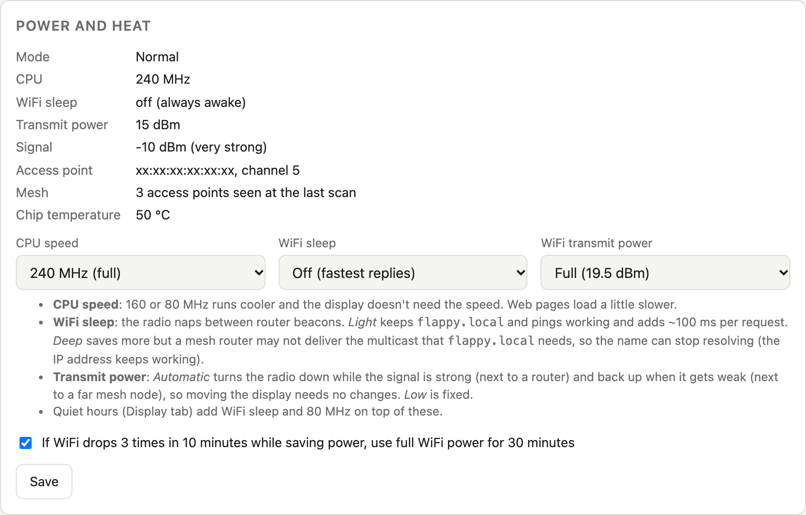

# Upgrading from the ESP-01S to an ESP32

This page is for people who **already have a working display** built from the original design
(ESP-01S master, Arduino Nano units) and want to move it to this fork. It explains *why* you would,
*what changes and what doesn't*, and gives the short version of the upgrade. The step-by-step
instructions (wiring, flashing, calibrating) are in the [build guide](./build-guide.md); this page
links to them instead of repeating them.

If you are building a display from scratch, skip this page: the build guide is all you need.

## Why change the master?

The ESP-01S is an ESP8266 with 80 KB of RAM and a single UART. That limits the original firmware
in ways that no amount of code cleanup fixes:

| ESP-01S (original) | ESP32 (this fork) |
|---|---|
| **Serial and I2C share the same two pins** (TX/RX are SDA/SCL). Open the serial monitor and the units stop answering, so you can't see a log while the display runs | I2C is on GPIO21/22, so **USB serial works at the same time**: live log, console, crash reports |
| ~80 KB of RAM, one core, WiFi and the display compete | Two 240 MHz cores and about 4x the RAM; WiFi runs on its own core |
| Slow web pages, and too little memory to also fetch and parse live data | A responsive web UI, and live data (weather, BART, Klipper printers) is fetched and parsed on the master |
| Updating means unplugging the ESP-01 and putting it in a programmer (no auto-reset) | Plug-in USB upload, then **over WiFi (OTA)** |
| WiFi trouble on mesh networks, little to debug with | Retries and best-access-point selection for WPA2/WPA3 mesh networks; the log tells you what happened |

The unit (Nano) firmware changes too, for a related reason: the master can only diagnose a unit if
the unit can report on itself. Unit firmware 2.x re-syncs at every magnet pass, learns its motor's
steps per turn, reports its supply voltage and missed magnets, recovers from I2C hangs, and can
sleep in quiet hours. The old unit firmware (1.3.0) has a known problem where waking from sleep can
leave the I2C bus stuck until you power-cycle the display.

## What changes, and what doesn't

**Unchanged: all the hardware you've built.**

- The PCB, the units, the motors, the DIP switch addresses, the 3D-printed parts and the enclosure.
- The ESP-01 socket stays on the board. You just don't use the ESP-01S any more.
- Each unit's **calibration offset** (stored in the Nano's EEPROM). Unit firmware 2.x reads it, so
  you don't have to recalibrate.

**Changed:**

- The master: an **original ESP32 dev board** (ESP32-WROOM-32: DevKitC, "ESP32 Dev Module", mini D1
  ESP32) jumpered to the ESP-01 header with **three wires**: SDA, SCL and GND.
  (S2, S3, C3 and C6 boards are not supported.)
- The firmware, both on the master and on every unit.
- How you configure WiFi: credentials go in a git-ignored `secrets.h` at build time. **There is no
  access-point setup portal any more.**
- Your **old settings are not migrated.** The old settings lived in the ESP-01's flash in a
  different format. Re-enter text, schedule and quiet hours in the new web UI (a few minutes).
- Where it lives on the network: `http://flappy.local` (or the fixed address you choose in
  `config.h`).

## What you need

- An original ESP32 dev board, three short jumper wires (or wire to solder) and a USB cable
- A computer with [PlatformIO](https://platformio.org) and Python 3.10-3.14
- The USB cable for your Nanos (you reflash each one)
- Your 2.4 GHz WiFi name and password
- About an evening: an hour for wiring and flashing, plus calibration checks

## The upgrade in six steps

1. **Take notes first.** Write down your text, schedule and quiet hours (or screenshot the old web
   page). Nothing is carried over.
2. **Wire the ESP32 to the header.** Remove the ESP-01S, then connect header **U2** pin 8 -> GPIO21
   (SDA), pin 4 -> GPIO22 (SCL), pin 1 (the square pad) -> GND. Power the ESP32 from its USB port
   while you test. [Build guide, step 1](./build-guide.md#1-wire-the-esp32-into-the-esp-01-header)
   and [esp32.md](./esp32.md).
3. **Set WiFi and flash the master.** Copy `secrets.h.example` to `secrets.h`, fill in your WiFi
   and a real OTA password, then `pio run -t upload && pio run -t uploadfs`.
   [Steps 2-4](./build-guide.md#2-install-the-tools).
   *At this point your old units (firmware 1.3.0) already work with the new master.* The master
   reads them the way the old firmware did, so you can stop here and check the display before
   touching the units.
4. **Flash the units.** One Nano at a time, `firmware/unit/flash.sh`. They keep their calibration.
   [Step 5](./build-guide.md#5-flash-the-units).
5. **Check addresses and calibration.** Console commands `ident`, `status`, `units`; recalibrate
   any unit that shows a neighbouring flap with `cal <address>`.
   [Step 6](./build-guide.md#6-calibrate).
6. **Power the ESP32 permanently.** Move from USB to the display's 5 V (or its 3.3 V, never both),
   see [Power](#power-and-heat) below, and from then on update over WiFi
   ([step 8](./build-guide.md#8-updates-over-wifi)).

You can do step 4 on a different evening: master first, units later, one at a time.

## Power and heat

An ESP32 draws noticeably more than an ESP-01S (about 250 mA on average with short peaks near
500 mA while WiFi is active). In a closed wooden or printed enclosure it can feel warm. Things
that help, in order of effect:

1. **Ventilation.** A few holes or slots near the ESP32 matter more than any software setting.
2. **Slower CPU.** The display doesn't need 240 MHz. In the web UI, **System -> Power and heat**,
   set the CPU to 160 or 80 MHz (the web pages load a little slower).
3. **WiFi sleep: Light.** The radio naps between router beacons. Expect ~100 ms more per
   request. Leave this off *Deep* on mesh networks: a mesh router may not deliver the multicast
   packets that `flappy.local` depends on, so the name can stop resolving while the IP address
   keeps working.
4. **Transmit power: Automatic.** Turns the radio down while the signal is strong (display next
   to the router) and back up when it is weak (next to a far mesh node), so moving the display
   needs no changes. It never goes below 8.5 dBm.
5. **Quiet hours** (Display tab) add WiFi sleep, 80 MHz and unit deep sleep on top.

A safety net is on by default: if WiFi drops three times in ten minutes while any WiFi power
saving is on, the master goes back to full WiFi power for 30 minutes.

The card also shows what is actually in effect (CPU speed, WiFi sleep mode, transmit power,
signal, access point, how many mesh nodes were seen) and the chip temperature when the chip
reports one:

## Going back

Nothing in the upgrade is destructive:

- Put the ESP-01S back in its socket and flash it with the sketch in
  [`legacy/ESPMaster`](../legacy/ESPMaster) (Arduino IDE, "Generic ESP8266 Module", 4MB FS:1MB).
  You will need to re-enter your settings there too.
- Units on firmware 2.x keep the same I2C addresses and the same EEPROM offset, so they stay
  calibrated. The legacy master doesn't use their diagnostics. Going back from 2.x to 1.3.0 on the
  units is also possible (`legacy/Unit`), but that has not been tested here, and 1.3.0 has the
  I2C-hang problem described above.

## What this has been tested on

One display: an ESP32 master, 10 units, a three-node mesh WiFi network. Details and the list of
what is not yet verified on hardware are in [whats-different.md](./whats-different.md#status-what-has-been-tested).
